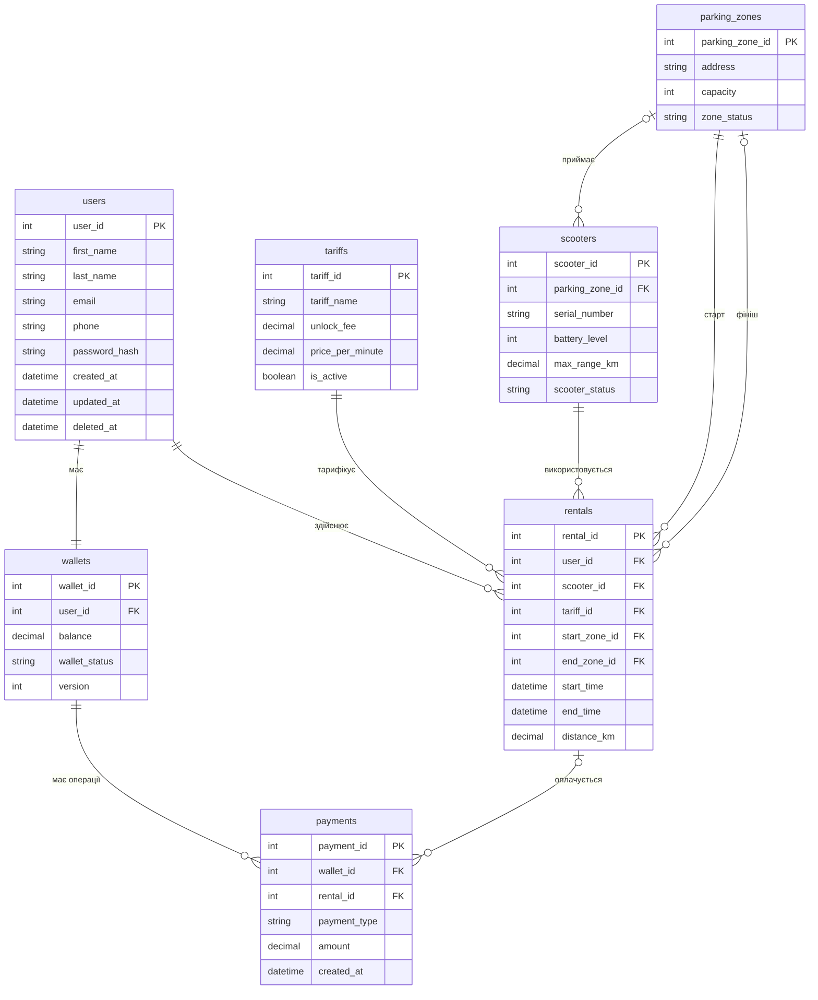

# Збір вимог та розробка схеми

## Обраний домен

Сервіс оренди електросамокатів (облік користувачів, їхніх гаманців, самокатів, паркувальних зон, тарифів, поїздок і платежів).

## 1. Вимоги до системи

**Призначення системи.** Система призначена для обліку самокатів і паркувальних зон, реєстрації користувачів, ведення їхніх гаманців, фіксації поїздок (старт і завершення) та автоматичного розрахунку їхньої вартості за тарифом.

**Зацікавлені сторони.** Користувач (орендує самокат), адміністратор (керує зонами, самокатами й тарифами, аналізує статистику).

**Дані для зберігання.**

- **Користувачі:** ім'я, прізвище, email, телефон, хеш пароля, дата створення й останнього оновлення, дата видалення (якщо акаунт деактивовано).
- **Гаманці:** власник, поточний баланс, статус (активний або заблокований), версія запису для контролю одночасних змін.
- **Платежі:** гаманець, поїздка (для списань і повернень), тип операції (поповнення, списання за поїздку, повернення), сума, дата й час.
- **Тарифи:** назва, вартість розблокування, ціна за хвилину, ознака активності.
- **Паркувальні зони:** адреса, місткість, статус (активна або неактивна).
- **Самокати:** серійний номер, поточна паркувальна зона (порожня, поки самокат у поїздці), рівень заряду батареї, максимальна дальність на повному заряді, статус.
- **Поїздки:** користувач, самокат, тариф, зона старту, зона завершення, час початку, час завершення, пройдена відстань.

---

## 2. Сутності та атрибути

У системі сім сутностей: **users** (користувачі), **wallets** (гаманці), **payments** (платежі), **tariffs** (тарифи), **parking_zones** (паркувальні зони), **scooters** (самокати) та **rentals** (поїздки). Rentals є асоціативною сутністю між користувачами та самокатами: вона зберігає тариф, зони, час і відстань кожної поїздки.

### Сутність 1. users (Користувачі)

| Атрибут          | Опис                                 | Тип даних   | Обмеження                                            |
| ---------------- | ------------------------------------ | ----------- | ---------------------------------------------------- |
| **user_id** (PK) | Унікальний ідентифікатор користувача | ціле число  | унікальний, обов'язковий                             |
| first_name       | Ім'я                                 | текст (64)  | обов'язковий                                         |
| last_name        | Прізвище                             | текст (64)  | обов'язковий                                         |
| email            | Електронна пошта                     | текст (255) | обов'язковий, унікальний серед активних користувачів |
| phone            | Номер телефону                       | текст (16)  | обов'язковий, міжнародний формат                     |
| password_hash    | Хеш пароля                           | текст (255) | обов'язковий                                         |
| created_at       | Дата й час створення                 | дата і час  | обов'язковий, за замовчуванням поточний час          |
| updated_at       | Дата й час останнього оновлення      | дата і час  | обов'язковий, за замовчуванням поточний час          |
| deleted_at       | Дата й час м'якого видалення         | дата і час  | необов'язковий (порожній для активного користувача)  |

### Сутність 2. wallets (Гаманці)

| Атрибут            | Опис                                    | Тип даних                     | Обмеження                                      |
| ------------------ | --------------------------------------- | ----------------------------- | ---------------------------------------------- |
| **wallet_id** (PK) | Унікальний ідентифікатор гаманця        | ціле число                    | унікальний, обов'язковий                       |
| user_id (FK)       | Власник гаманця                         | ціле число                    | обов'язковий, унікальний, посилається на users |
| balance            | Поточний баланс                         | число (10,2)                  | обов'язковий, за замовчуванням 0, ≥ 0          |
| wallet_status      | Статус гаманця                          | перелік (`active`, `blocked`) | обов'язковий, за замовчуванням `active`        |
| version            | Версія запису (оптимістичне блокування) | ціле число                    | обов'язковий, за замовчуванням 0               |

### Сутність 3. payments (Платежі)

| Атрибут             | Опис                                 | Тип даних                                     | Обмеження                                                        |
| ------------------- | ------------------------------------ | --------------------------------------------- | ---------------------------------------------------------------- |
| **payment_id** (PK) | Унікальний ідентифікатор платежу     | ціле число                                    | унікальний, обов'язковий                                         |
| wallet_id (FK)      | Гаманець, за яким проведено операцію | ціле число                                    | обов'язковий, посилається на wallets                             |
| rental_id (FK)      | Поїздка, до якої належить операція   | ціле число                                    | необов'язковий (порожній для поповнення), посилається на rentals |
| payment_type        | Тип операції                         | перелік (`top_up`, `rental_charge`, `refund`) | обов'язковий                                                     |
| amount              | Сума операції                        | число (10,2)                                  | обов'язковий, > 0                                                |
| created_at          | Дата й час операції                  | дата і час                                    | обов'язковий, за замовчуванням поточний час                      |

### Сутність 4. tariffs (Тарифи)

| Атрибут            | Опис                            | Тип даних   | Обмеження                             |
| ------------------ | ------------------------------- | ----------- | ------------------------------------- |
| **tariff_id** (PK) | Унікальний ідентифікатор тарифу | ціле число  | унікальний, обов'язковий              |
| tariff_name        | Назва тарифу                    | текст (50)  | обов'язковий, унікальний              |
| unlock_fee         | Вартість розблокування          | число (8,2) | обов'язковий, ≥ 0                     |
| price_per_minute   | Ціна за хвилину                 | число (8,2) | обов'язковий, > 0                     |
| is_active          | Чи діє тариф для нових поїздок  | булеве      | обов'язковий, за замовчуванням `true` |

### Сутність 5. parking_zones (Паркувальні зони)

| Атрибут                  | Опис                                  | Тип даних                      | Обмеження                               |
| ------------------------ | ------------------------------------- | ------------------------------ | --------------------------------------- |
| **parking_zone_id** (PK) | Унікальний ідентифікатор зони         | ціле число                     | унікальний, обов'язковий                |
| address                  | Адреса зони                           | текст (255)                    | обов'язковий, унікальний                |
| capacity                 | Місткість (максимум самокатів у зоні) | ціле число                     | обов'язковий, > 0                       |
| zone_status              | Статус зони                           | перелік (`active`, `inactive`) | обов'язковий, за замовчуванням `active` |

### Сутність 6. scooters (Самокати)

| Атрибут              | Опис                              | Тип даних                                                        | Обмеження                                                                       |
| -------------------- | --------------------------------- | ---------------------------------------------------------------- | ------------------------------------------------------------------------------- |
| **scooter_id** (PK)  | Унікальний ідентифікатор самоката | ціле число                                                       | унікальний, обов'язковий                                                        |
| parking_zone_id (FK) | Зона, у якій самокат стоїть зараз | ціле число                                                       | необов'язковий (порожній, коли самокат у поїздці), посилається на parking_zones |
| serial_number        | Серійний номер                    | текст (32)                                                       | обов'язковий, унікальний                                                        |
| battery_level        | Рівень заряду, %                  | мале ціле число                                                  | обов'язковий, від 0 до 100                                                      |
| max_range_km         | Дальність на повному заряді, км   | число (4,1)                                                      | обов'язковий, > 0                                                               |
| scooter_status       | Статус самоката                   | перелік (`available`, `rented`, `maintenance`, `decommissioned`) | обов'язковий                                                                    |

### Сутність 7. rentals (Поїздки)

| Атрибут            | Опис                                  | Тип даних   | Обмеження                                                                     |
| ------------------ | ------------------------------------- | ----------- | ----------------------------------------------------------------------------- |
| **rental_id** (PK) | Унікальний ідентифікатор поїздки      | ціле число  | унікальний, обов'язковий                                                      |
| user_id (FK)       | Хто орендує                           | ціле число  | обов'язковий, посилається на users                                            |
| scooter_id (FK)    | Який самокат                          | ціле число  | обов'язковий, посилається на scooters                                         |
| tariff_id (FK)     | За яким тарифом тарифікується поїздка | ціле число  | обов'язковий, посилається на tariffs                                          |
| start_zone_id (FK) | Зона, з якої почалася поїздка         | ціле число  | обов'язковий, посилається на parking_zones                                    |
| end_zone_id (FK)   | Зона, де поїздку завершено            | ціле число  | необов'язковий (порожній, поки поїздка активна), посилається на parking_zones |
| start_time         | Час початку                           | дата і час  | обов'язковий, за замовчуванням поточний час                                   |
| end_time           | Час завершення                        | дата і час  | необов'язковий (порожній, поки поїздка активна), > start_time                 |
| distance_km        | Пройдена відстань, км                 | число (6,2) | необов'язковий (заповнюється при завершенні), ≥ 0                             |

---

## 3. Зв'язки між сутностями

У спроектованій БД будуть існувати наступні зв'язки:

1. Користувач – Гаманець (users – wallets)
   - Тип зв'язку: one-to-one.
   - Опис: Кожен користувач має рівно один гаманець, а кожен гаманець належить одному користувачу. У таблиці wallets це фіксується через унікальний FK user_id.

2. Користувач – Поїздка (users – rentals)
   - Тип зв'язку: one-to-many.
   - Опис: Один користувач може здійснити багато поїздок, але кожна поїздка оформлюється на одного користувача. У таблиці rentals це фіксується через FK user_id.

3. Гаманець – Платіж (wallets – payments)
   - Тип зв'язку: one-to-many.
   - Опис: За одним гаманцем проводиться багато операцій, але кожна операція стосується одного гаманця. У таблиці payments це фіксується через FK wallet_id.

4. Поїздка – Платіж (rentals – payments)
   - Тип зв'язку: one-to-many (з необов'язковим боком платежу).
   - Опис: До однієї поїздки може належати кілька операцій (списання, повернення), а платіж стосується максимум однієї поїздки. Поповнення гаманця не має поїздки, тому rental_id у такому платежі порожній.

5. Тариф – Поїздка (tariffs – rentals)
   - Тип зв'язку: one-to-many.
   - Опис: За одним тарифом може бути оформлено багато поїздок, але кожна поїздка тарифікується за одним тарифом. У таблиці rentals це фіксується через FK tariff_id.

6. Самокат – Поїздка (scooters – rentals)
   - Тип зв'язку: one-to-many.
   - Опис: Один самокат може брати участь у багатьох поїздках (в різний час), але кожна поїздка виконується на одному самокаті. У таблиці rentals це фіксується через FK scooter_id.

7. Паркувальна зона – Самокат (parking_zones – scooters)
   - Тип зв'язку: one-to-many (з необов'язковим боком зони).
   - Опис: У зоні може стояти багато самокатів, а кожен самокат стоїть не більш ніж в одній зоні. Коли самокат у поїздці, parking_zone_id порожній.

8. Паркувальна зона – Поїздка, старт (parking_zones – rentals)
   - Тип зв'язку: one-to-many.
   - Опис: З однієї зони може початися багато поїздок, а кожна поїздка починається в одній зоні. Фіксується через FK start_zone_id.

9. Паркувальна зона – Поїздка, фініш (parking_zones – rentals)
   - Тип зв'язку: one-to-many (з необов'язковим боком поїздки).
   - Опис: В одній зоні може завершитися багато поїздок, а кожна завершена поїздка завершується в одній зоні. Поки поїздка активна, end_zone_id порожній.

---

## 4. ER-діаграма

---

## 5. Обмеження до системи

У спроектованій БД будуть діяти наступні обмеження:

**1. Первинні ключі (PRIMARY KEY)**

- users.user_id, wallets.wallet_id, payments.payment_id, tariffs.tariff_id, parking_zones.parking_zone_id, scooters.scooter_id, rentals.rental_id: унікальні та обов'язкові.

**2. Зовнішні ключі (FOREIGN KEY)**

- wallets.user_id має посилатися на існуючого користувача (users.user_id).
- payments.wallet_id має посилатися на існуючий гаманець (wallets.wallet_id).
- payments.rental_id, якщо заповнений, має посилатися на існуючу поїздку (rentals.rental_id).
- scooters.parking_zone_id, якщо заповнений, має посилатися на існуючу зону (parking_zones.parking_zone_id).
- rentals.user_id, rentals.scooter_id, rentals.tariff_id, rentals.start_zone_id мають посилатися на існуючі записи users, scooters, tariffs і parking_zones.
- rentals.end_zone_id, якщо заповнений, має посилатися на існуючу зону.
- Не можна видалити користувача, самокат, тариф чи зону, на які посилаються поїздки, а також гаманець, на який посилаються платежі (фінансова й історична інформація зберігається). Користувачі видаляються м'яко.

**3. Унікальність (UNIQUE)**

- wallets.user_id: один гаманець на користувача.
- users.email: унікальний серед активних користувачів (де `deleted_at` порожній).
- tariffs.tariff_name, parking_zones.address, scooters.serial_number: унікальні.
- Не більше однієї активної поїздки (`end_time` порожній) на користувача: унікальність `rentals.user_id` серед активних поїздок.
- Не більше однієї активної поїздки на самокат: унікальність `rentals.scooter_id` серед активних поїздок.

**4. Обов'язкові поля (NOT NULL)**

- users: first_name, last_name, email, phone, password_hash, created_at, updated_at.
- wallets: user_id, balance, wallet_status, version.
- payments: wallet_id, payment_type, amount, created_at.
- tariffs: tariff_name, unlock_fee, price_per_minute, is_active.
- parking_zones: address, capacity, zone_status.
- scooters: serial_number, battery_level, max_range_km, scooter_status.
- rentals: user_id, scooter_id, tariff_id, start_zone_id, start_time.
- Необов'язкові: users.deleted_at, payments.rental_id, scooters.parking_zone_id, rentals.end_zone_id, rentals.end_time, rentals.distance_km.

**5. Перевірка значень (CHECK)**

- wallets.balance ≥ 0.
- payments.amount > 0.
- tariffs.unlock_fee ≥ 0, tariffs.price_per_minute > 0.
- parking_zones.capacity > 0.
- scooters.battery_level від 0 до 100, scooters.max_range_km > 0.
- rentals.end_time > rentals.start_time (якщо заповнено), rentals.distance_km ≥ 0.
- Поля rentals.end_time, rentals.end_zone_id та rentals.distance_km або всі порожні (поїздка активна), або всі заповнені (поїздка завершена).
- Платіж типу `top_up` не має rental_id, платежі `rental_charge` і `refund` мають rental_id.
- Самокат зі статусом `available` має заповнену parking_zone_id, а зі статусом `rented` має порожню.
- users.phone відповідає міжнародному формату (знак «+» і від 10 до 15 цифр).

**6. Допустимі значення (ENUM) та значення за замовчуванням (DEFAULT)**

- wallets.wallet_status: `active`, `blocked` (за замовчуванням `active`).
- payments.payment_type: `top_up` (поповнення), `rental_charge` (списання за поїздку), `refund` (повернення).
- parking_zones.zone_status: `active`, `inactive` (за замовчуванням `active`).
- scooters.scooter_status: `available`, `rented`, `maintenance`, `decommissioned`.
- tariffs.is_active за замовчуванням `true`, wallets.balance за замовчуванням 0, wallets.version за замовчуванням 0.
- users.created_at, users.updated_at, payments.created_at та rentals.start_time за замовчуванням дорівнюють поточному часу.
